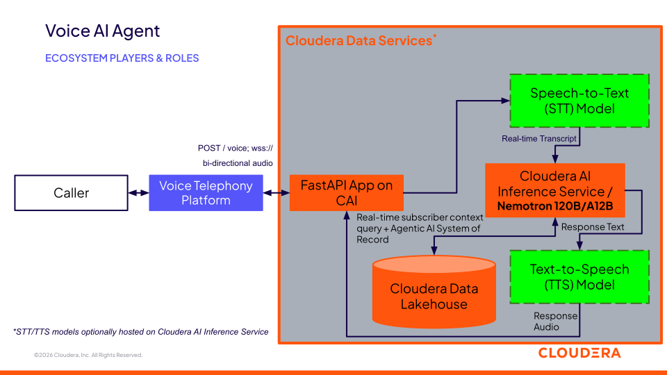
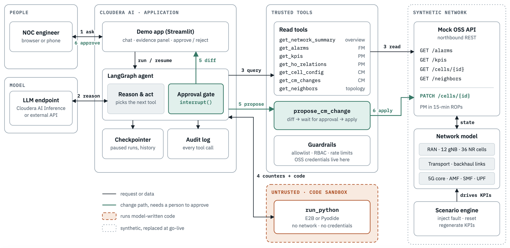

# Closed-Loop RAN Care

*Concept note — AI-RAN Alliance, Working Group 3 (AI-on-RAN)*

A single agent that hears a customer's problem, reads it against live RAN signals, and proposes the fix a NOC engineer would — with a person still deciding what touches the network.

**Prepared by** Athul Prasad, Cloudera AI · **Status** concept, seeking WG3 feedback

---

Today, a customer calling in about dropped calls and a NOC engineer looking at a handover-success dashboard are investigating the same fault from two systems that never talk. This note proposes closing that loop: a voice agent that can correlate what a caller is telling it with live network signals, and — within the same guardrails a human NOC engineer already trusts — propose and, once approved, carry out the fix.

## 01 · The gap today

Customer-facing support agents, AI or human, reason over account and billing data. They have no visibility into the radio network actually carrying the call. NOC tooling is the reverse: it reasons over alarms, counters and configuration, with no notion of which customers are affected or that one of them is on the phone right now, describing the symptom in plain language.

The result is two separate investigations of the same fault, on two timelines, reconciled by neither system.

## 02 · The concept

One reasoning layer, two interaction surfaces, sharing a data plane:

- **Customer interaction plane** — real-time voice, grounded in account context, built on Cloudera AI Inference Service.
- **Network intelligence plane** — an agent that reads alarms, performance counters and configuration, analyses them with code it writes and runs in a sandbox, and proposes a configuration change exactly as a NOC engineer would.
- **Shared gate** — nothing is applied to the live network without a person approving the exact diff, with guardrails checked first.

**Flow:** Caller ("calls keep dropping") → Voice agent (STT · LLM · TTS) → correlates with Live RAN signals (alarms · counters · topology) → Diagnosis (sandboxed analysis) → proposes fix → **Human approval** (guardrails checked first) → approved → Network change → Confirm recovery (next measurement period) → agent calls the customer back to close the loop.

## 03 · Grounding reasoning in a certified ontology

Neither prototype has a semantic layer today. The network agent's tools are fixed function calls over alarm, performance and configuration tables — its judgment about which table answers a given question lives entirely in its prompt, not in anything checked or certified. That does not scale past a synthetic 36-cell network, and it gives a NOC engineer nothing to audit before trusting an answer.

NVIDIA's [Auto Ontology](https://github.com/NVIDIA/auto-ontology) frames this as three stages: generate, certify, answer. An LLM reads the data sources and proposes *terms* — business concepts such as *Handover Success Rate* or *Neighbour Relation*, each mapped to the columns that hold it — plus the *relationships* between them and reviewed query expressions. A person certifies the terms before they're trusted. At question time, the agent first checks whether the question is *answerable* from certified terms, retrieves only the relevant ones, and only then queries the underlying data, with the path from question to answer traceable back to a certified definition.

Adapted to this domain, that generate–certify–answer pattern is what the network agent's reasoning phase should run on: a certified vocabulary of alarms, counters, configuration attributes and — once built — the subscriber-to-cell relationship, so the agent's first move on a new question is working out which certified terms cover it, not guessing which tool to call.

**Flow:** Generate (LLM proposes terms + relationships from FM/PM/CM) → **Certify** (domain expert reviews before a term is trusted) → Answer (checks answerability, retrieves only the relevant certified terms) → feeds Diagnosis (same step as section 02).

## 04 · Worked example

*Illustrative — synthetic network, staged fault*

A customer calls in: *"My calls keep dropping near my house."* The voice agent, grounded in the caller's account and approximate location, checks the certified ontology for terms that cover connection drops near a cell — *Handover Success Rate* and *Neighbour Relation* answer it, *Backhaul Utilisation* does not, so only the first two are retrieved. Against those, live RAN signals show handover success degraded on the serving sector. Sandboxed analysis traces the failures to a specific neighbour relation, and a change log shows a small cell commissioned nearby that morning using a PCI already in use two hops away — a classic PCI confusion fault.

The agent proposes a new PCI for the small cell, checked against the same guardrails a NOC engineer's tooling already enforces: uniqueness within two hops, a mod-3 separation check, a per-session change budget. The proposal — and the exact configuration diff — pauses for a person to approve. Once approved, the agent confirms handover success recovers at the next measurement period and calls the customer back to close the loop.

## 05 · What's proven today, and what's proposed

Both halves exist today as separate, working prototypes on Cloudera AI Inference Service, and a first slice of the correlation between them — a caller's home cell checked against a known-issue lookup — now runs end to end. The two agents' reasoning and data planes have not yet been joined, and the figure above is a proposed architecture, not a built one.

| Piece | Status | What's demonstrated |
|---|---|---|
| Voice agent | **proven** | Real-time phone calls over Twilio Media Streams; pluggable speech-to-text and text-to-speech; LLM reasoning grounded in account context, served by Cloudera AI Inference Service. |
| Network agent | **proven** | A LangGraph agent investigates a staged PCI-confusion fault on a synthetic 12-gNB, 36-cell radio network — reads alarms/counters/config, analyses in a sandbox, proposes a fix, pauses for human approval, logs every step. |
| Shared reasoning + data plane | *proposed* | Joining the two agents so a caller's report can trigger the network investigation, and the outcome can be spoken back to the caller. |
| Subscriber-to-cell correlation | **phase 1 proven** | A static `home_cell_id` on the customer record, checked against a cell-health lookup on every call, now runs end to end in the voice agent — a known issue on the caller's cell is surfaced on the live dashboard and the agent proactively raises it. The lookup itself is still a static table, not a live network feed; phases 2 (time-indexed current-serving-cell, to model mobility) and 3 (live attach-state from real or anonymized operator data) remain proposed. |
| RAN-edge colocation | *proposed* | Both agents run centrally today. Moving inference closer to the radio for latency is an open architecture question, to validate jointly with the relevant platform and infrastructure teams rather than assume. |
| Ontology layer | *proposed* | No certified vocabulary exists yet. The network agent's tools are fixed function calls today; generating, certifying and querying against a term layer (Section 03) is new work, inspired by but not built from NVIDIA's Auto Ontology. |

What the "proven" row above looks like today — each diagram is the architecture as published in its own repository:

| [voice-ai-agent](https://github.com/athpra/voice-ai) | [mobile-noc-agent-demo](https://github.com/athpra/mobile-noc-agent-demo) |
|---|---|
|  |  |
| real-time call handling, Cloudera AI Inference Service, pluggable STT/TTS | LangGraph investigation agent, sandboxed analysis, guardrailed change approval |

## 06 · Why this belongs in WG3

- It is driven by signals only the RAN produces — alarms, performance counters, topology — not just subscriber/account data, which is the core premise of AI-on-RAN.
- It targets RAN-edge colocated inference as the deployment model to work toward, not a cloud-only system incidentally applied to telecom.
- The proposed fix and approval step map naturally onto a RIC-style control loop — an xApp or rApp that observes, reasons and recommends, with a person still in the actuation path — the vocabulary this group already works in.
- The human-approval gate is the trust mechanism a working group chartered around AI acting on live radio networks will be asked about by anyone evaluating this seriously, so it is designed in from the start rather than added later.
- A certified ontology gives the same group a second, earlier trust mechanism: a record of what data the agent was even allowed to consider, checkable before the diagnosis is, not just the action.

## 07 · What we're asking

1. Whether this concept fits WG3's current charter and roadmap, and where it would sit alongside existing workstreams.
2. Interest in a working session to walk through both running prototypes and the integration plan in more depth.
3. Whether a reference operator would be open to validating the concept against anonymized real network data, once the synthetic integration is working end to end.

---

Athul Prasad · Cloudera AI
